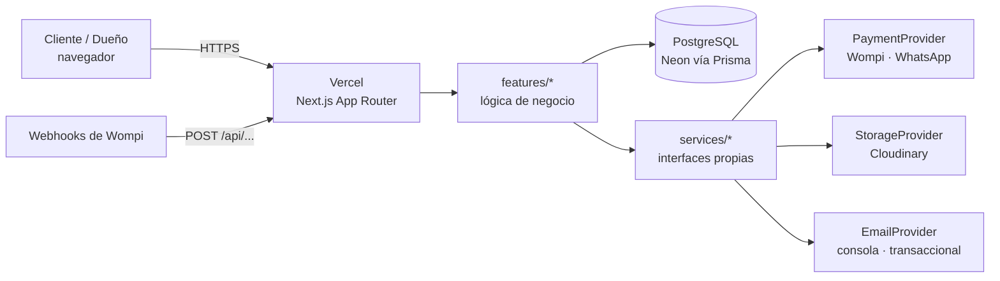

# Arquitectura

## Vista general

## Capas

| Capa            | Carpeta                     | Responsabilidad                                               | Puede depender de |
| --------------- | --------------------------- | ------------------------------------------------------------- | ----------------- |
| Presentación    | `src/app`, `src/components` | Rutas, páginas, UI. Server Components por defecto             | features, lib     |
| Dominio         | `src/features/<dominio>`    | Reglas de negocio: catálogo, carrito, checkout, pedidos, auth | services, lib     |
| Integraciones   | `src/services/<tipo>`       | Adaptadores a proveedores externos detrás de interfaces       | lib               |
| Infraestructura | `src/lib`                   | `env` validado, cliente Prisma, formatos es-CO/COP            | —                 |

Reglas:

- Las dependencias van **hacia abajo**; un servicio nunca importa de `features` ni de `app`.
- Ningún SDK de proveedor (Wompi, Cloudinary, correo) se importa fuera de `src/services/`.
- El proveedor concreto se elige con variables de entorno (`PAYMENT_PROVIDER`,
  `STORAGE_PROVIDER`, `EMAIL_PROVIDER`): cambiar de proveedor es cambiar configuración, no código.

## Rutas (route groups)

- `(shop)`: `/`, catálogo, producto, carrito, checkout.
- `(auth)`: login y registro.
- `admin`: panel del dueño, protegido por rol `ADMIN` en el servidor.
- `api`: webhooks (Wompi) y endpoints.

> Este documento se amplía en cada paso (modelo de datos en el Paso 2, auth en el Paso 3…).
