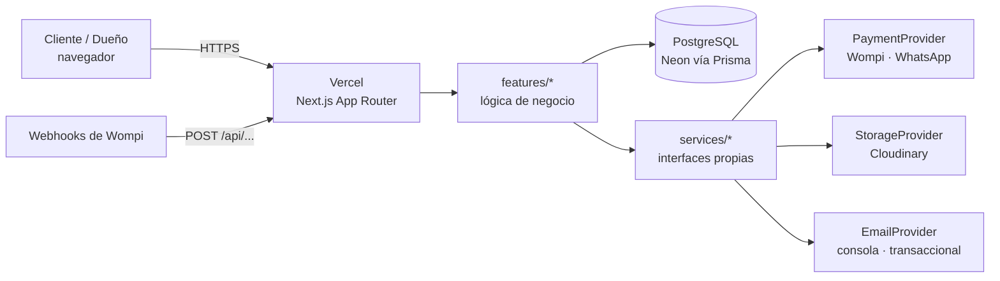
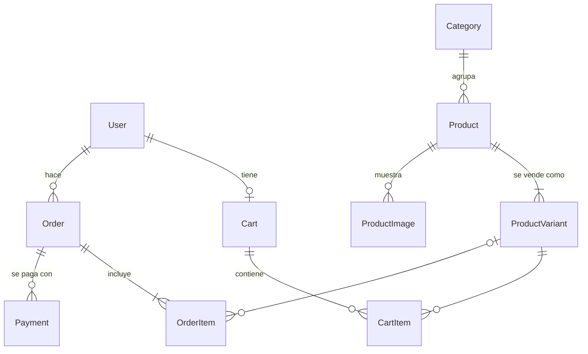

# Arquitectura

## Vista general

## Capas

| Capa            | Carpeta                     | Responsabilidad                                               | Puede depender de |
| --------------- | --------------------------- | ------------------------------------------------------------- | ----------------- |
| Presentación    | `src/app`, `src/components` | Rutas, páginas, UI. Server Components por defecto             | features, lib     |
| Dominio         | `src/features/<dominio>`    | Reglas de negocio: catálogo, carrito, checkout, pedidos, auth | services, lib     |
| Integraciones   | `src/services/<tipo>`       | Adaptadores a proveedores externos detrás de interfaces       | lib               |
| Infraestructura | `src/lib`                   | `env` validado, cliente Prisma, formatos es-CO/COP            | —                 |

Reglas:

- Las dependencias van **hacia abajo**; un servicio nunca importa de `features` ni de `app`.
- Ningún SDK de proveedor (Wompi, Cloudinary, correo) se importa fuera de `src/services/`.
- El proveedor concreto se elige con variables de entorno (`PAYMENT_PROVIDER`,
  `STORAGE_PROVIDER`, `EMAIL_PROVIDER`): cambiar de proveedor es cambiar configuración, no código.

## Rutas (route groups)

- `(shop)`: `/`, catálogo, producto, carrito, checkout.
- `(auth)`: login y registro.
- `admin`: panel del dueño, protegido por rol `ADMIN` en el servidor.
- `api`: webhooks (Wompi) y endpoints.

## Modelo de datos

Fuente de verdad: [`prisma/schema.prisma`](../prisma/schema.prisma). Montos en COP como enteros.

- **Variantes:** cada producto se vende en una o más variantes con precio propio (8 o 16 porciones, caja x6 o x12).
- **Invitados:** el carrito de un invitado se identifica con una cookie; el pedido guarda nombre, correo y teléfono, y `userId` es opcional.
- **Snapshot:** `OrderItem` copia nombre y precio al comprar; cambiar un producto no altera pedidos pasados.
- **Pagos:** un `Payment` por intento (Wompi exige una referencia única por transacción).
- **Entrega:** `DELIVERY` (con dirección y costo de envío) o `PICKUP`, con fecha de entrega.

## Autenticación

Better Auth ([ADR 0003](adr/0003-better-auth.md)). Código en `src/features/auth/`.

| Pieza                 | Archivo                              | Función                                                      |
| --------------------- | ------------------------------------ | ------------------------------------------------------------ |
| Configuración         | `auth.ts`                            | Correo y contraseña, verificación, rol, límite de intentos   |
| API HTTP              | `src/app/api/auth/[...all]/route.ts` | Endpoints `/api/auth/*`                                      |
| Cliente               | `client.ts`                          | Ingreso, registro y salida desde el navegador                |
| Sesión en el servidor | `session.ts`                         | `getSession()`, `requireUser()`, `requireAdmin()`            |
| Redirección rápida    | `src/proxy.ts`                       | Envía al login si no hay cookie (no es control de seguridad) |

Reglas:

- **`requireAdmin()` en cada página y server action del panel.** El proxy y el layout ayudan,
  pero la verificación válida es la que corre junto a los datos.
- Un cliente que abre `/admin` ve "Página no encontrada": no se revela que el panel existe.
- El rol `ADMIN` se asigna a cada correo de `ADMIN_EMAILS` cuando ese correo se verifica.
- Puede haber varios admins. Quitar un correo de `ADMIN_EMAILS` no le quita el rol: eso se
  hace cambiando `role` a `CUSTOMER` en `npm run db:studio`.
- El rol nunca se puede enviar desde el formulario de registro (`input: false`).
- **Rendimiento:** la sesión se guarda 5 minutos en una cookie firmada (`cookieCache`) y
  `getSession()` se deduplica por petición con `cache`, así que la mayoría de las páginas no
  consultan la base de datos para saber quién es el usuario. `requireAdmin()` sí lee siempre
  la base de datos, para que un cambio de rol aplique al instante.

## Catálogo

Código en `src/features/catalog/`. Rutas: `/`, `/productos`, `/categorias/[slug]`, `/productos/[slug]`.

- **Caché:** las consultas usan `"use cache"` con la etiqueta `catalog` y duran 1 hora. Así casi
  no se consulta Neon (ahorra horas de cómputo del plan gratis). Cada cambio del panel a
  productos o categorías **debe** llamar `updateTag(CATALOG_TAG)` para que se vea al instante.
- **Build con base de datos:** `/` y `/productos` se prerenderizan en el build, así que el build
  necesita `DATABASE_URL` con datos. En CI se usa un PostgreSQL temporal con migraciones y seed.
- **Fotos:** si un producto no tiene fotos se muestra una ilustración de su categoría
  (`public/images/placeholders/`). Las fotos reales llegan con Cloudinary en el Paso 5.
- Solo se muestran productos activos, de categorías activas y con al menos una variante activa.

## Carrito

Código en `src/features/cart/`. Página `/carrito` y contador en el encabezado.

- **Invitados:** el carrito se identifica con la cookie `melange_cart` (`httpOnly`, 30 días),
  que guarda un id imposible de adivinar. **Usuarios:** un carrito por usuario (`carts.userId`).
- **Al ingresar o registrarse** se fusiona el carrito de invitado con el del usuario
  (`mergeGuestCart`): misma variante → se suman las cantidades, máximo 20 por ítem.
- **Precios siempre actuales:** el carrito guarda variante y cantidad, no precios. El precio se
  lee de la base de datos al mostrarlo y se volverá a calcular en el servidor al pagar.
- Productos o variantes desactivados desaparecen del carrito automáticamente.
- Toda acción (`actions.ts`) valida con Zod y solo toca ítems del carrito del visitante.
- Pendiente: limpiar carritos de invitado abandonados (tarea programada, Paso 6).

## Checkout y pedidos

Código en `src/features/checkout/` y `src/features/orders/`. Rutas `/checkout` y `/pedidos/[token]`.

- **Entrega:** a domicilio (zona con su costo) o recoger en la sede (Parque de La Floresta).
  Las zonas (`delivery_zones`) y la disponibilidad (`store_settings`, `blocked_dates`) viven en
  la base de datos; el dueño las editará en el panel (Paso 5).
- **Fechas:** día calendario de Bogotá. Se ofrecen las que cumplen anticipación mínima, días de
  trabajo, fechas bloqueadas y cupo diario (`availability.ts`, funciones puras con pruebas).
  El cliente las elige en un **calendario mensual** propio (`date-calendar.tsx`, sin librerías):
  semana de lunes a domingo; los días no disponibles aparecen tachados y deshabilitados.
- **Calendario de la dueña:** `/admin/calendario` (ver sección Panel).
- **`placeOrder` recalcula todo en el servidor:** precios desde la base de datos, costo de la
  zona y disponibilidad de la fecha. Los totales del formulario son solo informativos.
- **Pedido:** número visible desde #1001, copia de productos y precios (`order_items`), un
  `Payment` por intento y vaciado del carrito, todo en una transacción.
- **Enlace del pedido:** `/pedidos/<token>` con un token aleatorio de 32 caracteres (los
  invitados no tienen cuenta). No se indexa y se envía por correo al cliente.
- **Pago:** detrás de `PaymentProvider` (`src/services/payments/`), elegido con
  `PAYMENT_PROVIDER`. Hoy `whatsapp`: el cliente envía el pedido con un mensaje ya armado y el
  dueño confirma y acuerda el pago. En el Paso 4.4 se agrega `wompi` sin tocar el checkout.

## Panel de la dueña

Rutas bajo `/admin` (rol `ADMIN`): **Resumen**, **Pedidos**, **Calendario**, **Productos**,
**Categorías** y **Configuración**. Las fotos con Cloudinary quedan pendientes hasta que la
dueña tenga su cuenta ([issue #15](https://github.com/Nicolas-2307/melange/issues/15)).

- **Resumen:** pedidos por confirmar, pedidos abiertos y próximas entregas.
- **Pedidos:** filtros (abiertos, por confirmar, entregados, cancelados, todos) y detalle con datos
  del cliente (WhatsApp, llamada, correo), productos, entrega y pago.
- **Estados:** `PENDING → CONFIRMED → PREPARING → READY → COMPLETED`, un paso a la vez, y
  `CANCELLED` antes de entregar (`status.ts`). La actualización es condicional: si otra sesión
  cambió el pedido mientras tanto, no se sobrescribe.
- **Pago por WhatsApp:** la dueña registra el pago recibido (`payments.status = APPROVED`).
- **Calendario:** vista mensual con el número de pedidos por día. Al tocar un día se ven sus
  pedidos y se puede **bloquear o desbloquear** (con motivo). El bloqueo aplica de inmediato al
  calendario del checkout; los pedidos ya hechos para ese día no se tocan.
- **Productos:** crear y editar nombre, dirección (slug, generada del nombre), descripción,
  categoría, presentaciones con precio (orden, disponibles o no), visible y destacado. Una
  presentación ya pedida no se borra: se desactiva, para que el historial de pedidos no pierda la
  referencia.
- **Categorías:** crear y editar nombre, dirección, descripción, orden y visibilidad.
- **Caché:** cada cambio de catálogo llama `updateTag(CATALOG_TAG)`; la tienda lo muestra al
  instante (hay una prueba e2e que lo verifica).
- **Configuración:** dirección de la sede, días de trabajo, anticipación mínima y máximo de
  pedidos por día, más las **zonas de domicilio** (crear, editar valor, ocultar, eliminar). Se
  aplica de inmediato en el checkout. Eliminar una zona no cambia pedidos pasados (guardan una
  copia del nombre).
- Todas las páginas y acciones llaman `requireAdmin()`.

> Este documento se amplía en cada paso (productos y configuración en 5.2 y 5.3…).
