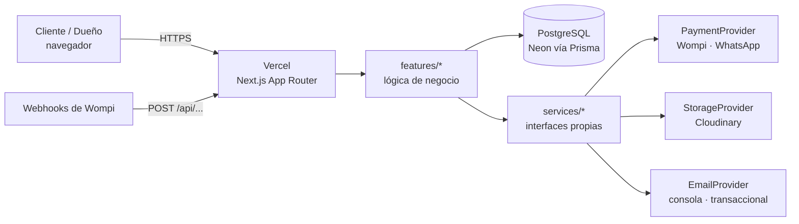
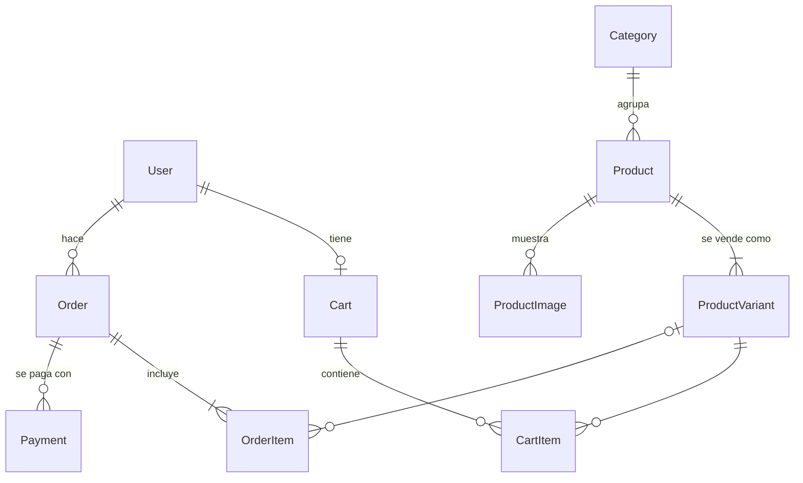

# Arquitectura

## Vista general

## Capas

| Capa            | Carpeta                     | Responsabilidad                                               | Puede depender de |
| --------------- | --------------------------- | ------------------------------------------------------------- | ----------------- |
| Presentación    | `src/app`, `src/components` | Rutas, páginas, UI. Server Components por defecto             | features, lib     |
| Dominio         | `src/features/<dominio>`    | Reglas de negocio: catálogo, carrito, checkout, pedidos, auth | services, lib     |
| Integraciones   | `src/services/<tipo>`       | Adaptadores a proveedores externos detrás de interfaces       | lib               |
| Infraestructura | `src/lib`                   | `env` validado, cliente Prisma, formatos es-CO/COP            | —                 |

Reglas:

- Las dependencias van **hacia abajo**; un servicio nunca importa de `features` ni de `app`.
- Ningún SDK de proveedor (Wompi, Cloudinary, correo) se importa fuera de `src/services/`.
- El proveedor concreto se elige con variables de entorno (`PAYMENT_PROVIDER`,
  `STORAGE_PROVIDER`, `EMAIL_PROVIDER`): cambiar de proveedor es cambiar configuración, no código.

## Rutas (route groups)

- `(shop)`: `/`, catálogo, producto, carrito, checkout.
- `(auth)`: login y registro.
- `admin`: panel del dueño, protegido por rol `ADMIN` en el servidor.
- `api`: webhooks (Wompi) y endpoints.

## Modelo de datos

Fuente de verdad: [`prisma/schema.prisma`](../prisma/schema.prisma). Montos en COP como enteros.

- **Variantes:** cada producto se vende en una o más variantes con precio propio (8 o 16 porciones, caja x6 o x12).
- **Invitados:** el carrito de un invitado se identifica con una cookie; el pedido guarda nombre, correo y teléfono, y `userId` es opcional.
- **Snapshot:** `OrderItem` copia nombre y precio al comprar; cambiar un producto no altera pedidos pasados.
- **Pagos:** un `Payment` por intento (Wompi exige una referencia única por transacción).
- **Entrega:** `DELIVERY` (con dirección y costo de envío) o `PICKUP`, con fecha de entrega.

## Autenticación

Better Auth ([ADR 0003](adr/0003-better-auth.md)). Código en `src/features/auth/`.

| Pieza                 | Archivo                              | Función                                                      |
| --------------------- | ------------------------------------ | ------------------------------------------------------------ |
| Configuración         | `auth.ts`                            | Correo y contraseña, verificación, rol, límite de intentos   |
| API HTTP              | `src/app/api/auth/[...all]/route.ts` | Endpoints `/api/auth/*`                                      |
| Cliente               | `client.ts`                          | Ingreso, registro y salida desde el navegador                |
| Sesión en el servidor | `session.ts`                         | `getSession()`, `requireUser()`, `requireAdmin()`            |
| Redirección rápida    | `src/proxy.ts`                       | Envía al login si no hay cookie (no es control de seguridad) |

Reglas:

- **`requireAdmin()` en cada página y server action del panel.** El proxy y el layout ayudan,
  pero la verificación válida es la que corre junto a los datos.
- Un cliente que abre `/admin` ve "Página no encontrada": no se revela que el panel existe.
- El rol `ADMIN` se asigna a cada correo de `ADMIN_EMAILS` cuando ese correo se verifica.
- Puede haber varios admins. Quitar un correo de `ADMIN_EMAILS` no le quita el rol: eso se
  hace cambiando `role` a `CUSTOMER` en `npm run db:studio`.
- El rol nunca se puede enviar desde el formulario de registro (`input: false`).

> Este documento se amplía en cada paso (tienda en el Paso 4…).
